# Sparky Shell

A monochrome-glass desktop shell for **KDE Plasma 6 (Wayland)**, written in
[Quickshell](https://quickshell.org) (QML). It replaces Plasma's panel, launcher,
notifications and most of the system dialogs with its own, while KWin stays the
compositor underneath.

One look everywhere: translucent near-black glass with real blur, soft white
fills instead of outlines, pill buttons, Google Sans Flex, and short ease-out
motion on everything.

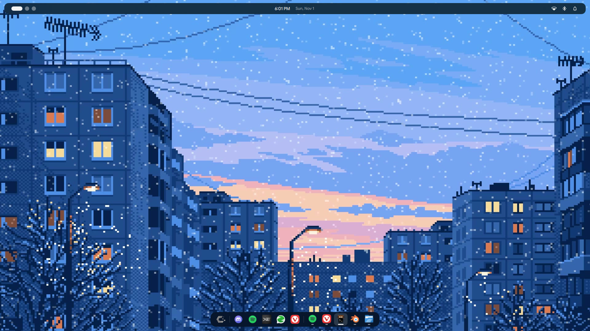

---

## What's in it

| | |
|---|---|
| **Dock** | Floating, centred, only as wide as its icons. Start button, pinned apps (drag to reorder), open apps after a divider with a running underbar. Slides away when the active window is maximized or fullscreen; push the pointer to the bottom edge to bring it back. |
| **Top bar** | A thin glass strip along the top: desktops as dots on the left (the current one a wide pill; click, scroll or + to add), the time and date in the middle, Wi-Fi, Bluetooth and notification bells on the right, each opening a small panel (switch, connect / disconnect, Do Not Disturb). Rearrange it in Settings by dragging pieces between the left, centre and right, or onto a shelf to hide them; adjust the spacing, or switch the bar off. |
| **Tray** | Apps running in the background sit at the end of the dock as small icons; click to open, right-click for their menu. |
| **Launcher** | `Meta` opens a search at the top centre. Letters fade and rise in as you type, results glide, right-click a result to pin it. |
| **Notifications** | Sparky is the notification server. Cards slide in from the edge, stack and swipe away; actions, images, a countdown that pauses on hover. Do Not Disturb, position, timeout, sound in Settings. |
| **Settings** (`Meta+I`) | Customization (wallpapers: images, GIFs and videos, with history; display resolution and refresh rate), Controls (rebind every shortcut, add custom ones), Mouse (speed, acceleration, scroll speed and direction, left-handed), Notifications, Wi-Fi (join, password, forget; rows glide when you switch networks), Bluetooth (pair, connect, rename, battery). Your account and a power button at the bottom of the sidebar. |
| **Power menu** (`Ctrl+Alt+Delete`, or right-click the start button) | Lock, sleep, log out, restart, shut down; the last three count down and can be cancelled. |
| **Desktop switcher** (`Meta+Tab`) | Every virtual desktop with the apps open on it. Drag an app's icon onto another desktop to move the window there; add, remove, rename desktops. |
| **Window switcher** (`Alt+Tab`) | A KWin task-switcher theme: live thumbnails, a gliding highlight, close windows with the × or `Q`. |
| **Clipboard** (`Meta+V`) | History of text and images, searchable. |
| **Screen snip** (`Meta+Shift+S`) | Drag a region; a preview card offers copy / save / open. |
| **Open with** | Sparky's own "choose an application" dialog, for every app that asks (xdg-desktop-portal AppChooser). |
| **Screen-share picker** | Replaces KDE's "what do you want to share" dialog for every app (Discord, OBS, browsers). Pick a screen or a window; KDE still does the capture. |
| **Admin password prompt** | Sparky is the polkit agent: the "an app wants to make changes" dialog is sparky's own. |
| **Lock screen** | The login screen's design when the session locks (idle for 5 minutes, waking from sleep, `Meta+L`): weather, system info, now playing with media controls, clock, password, resources, calendar. A KDE lock-screen package, so KDE still handles the locking. |
| **Login screen** | A greetd greeter in the same style: weather, system info, session picker, clock, avatar, resources, calendar. Password dots pop in as you type; signing in zooms the panel away into a splash that hands over to the desktop as the dock rises. |
| **Window motion** | A KWin effect: windows rise in on open, settle out on close, shrink into the dock on minimize and come back out of it. |
| **Cursor** | "Breeze Sparky": Breeze, except the grab hand fades in from the arrow instead of swapping in at once. |
| **Task Manager & App Manager** | GTK 4 apps in the same look (blurred glass): processes (sort presets like Most CPU / Least memory) and live performance graphs; installed apps, updates, and installing `.deb` / `.rpm` / `.AppImage` files. |

## Screenshots

| | |
|---|---|
| 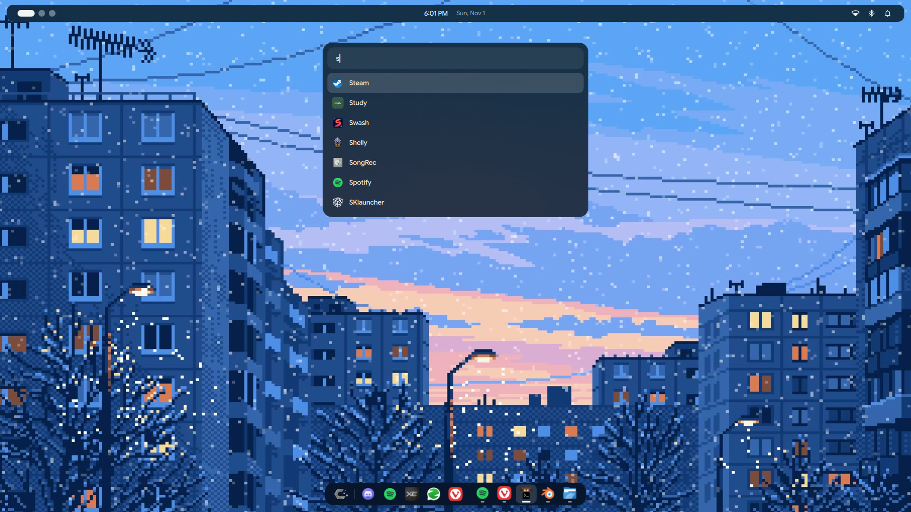 | 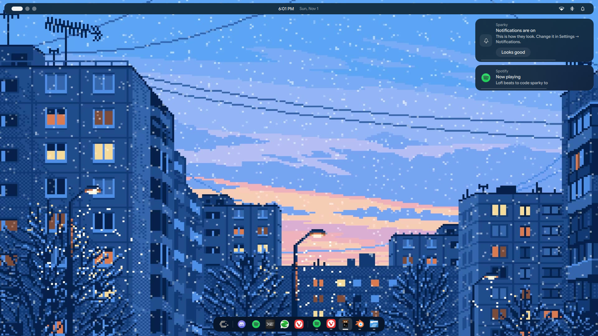 |
| Launcher | Notifications |
| 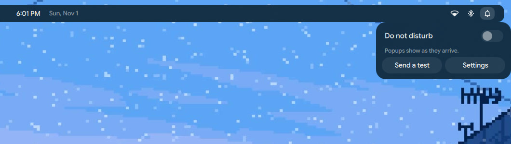 | 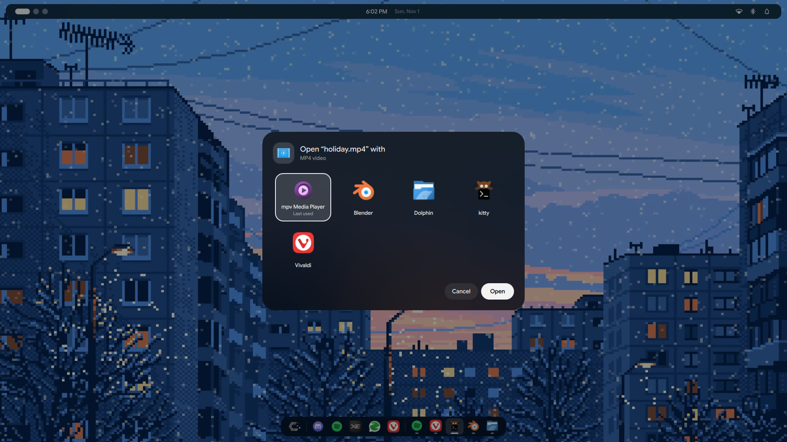 |
| Top bar: Do Not Disturb panel | "Open with" chooser |
| 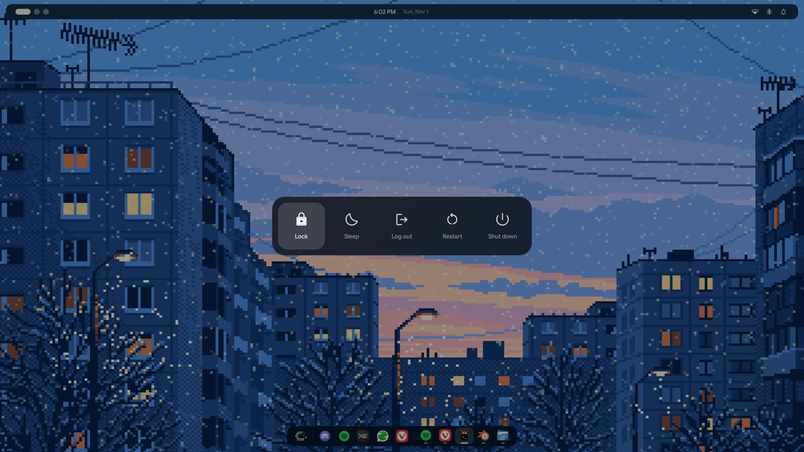 | 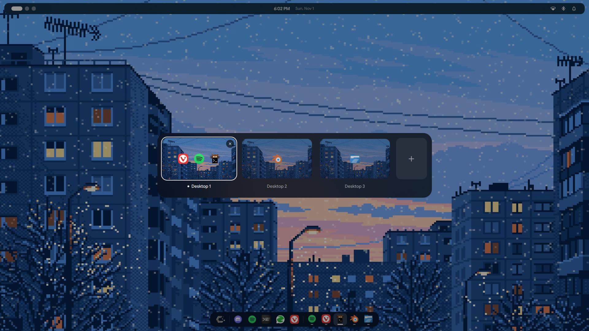 |
| Power menu | Desktop switcher |
| 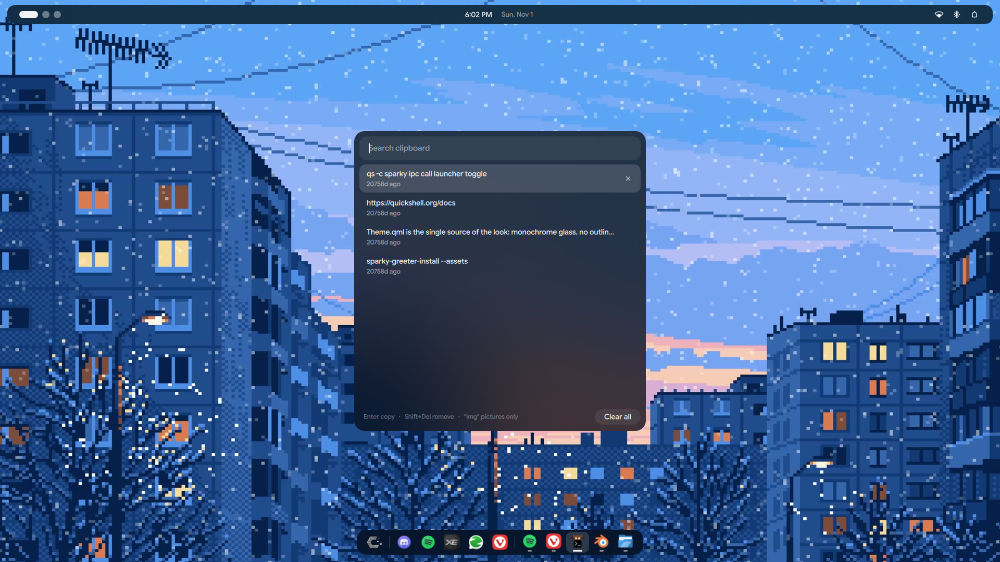 | 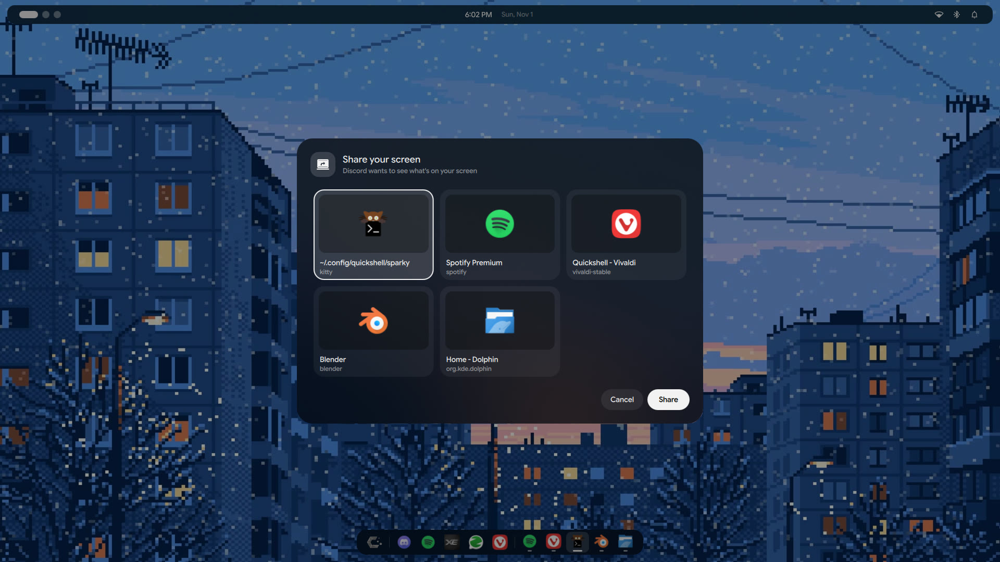 |
| Clipboard | Screen-share picker |
| 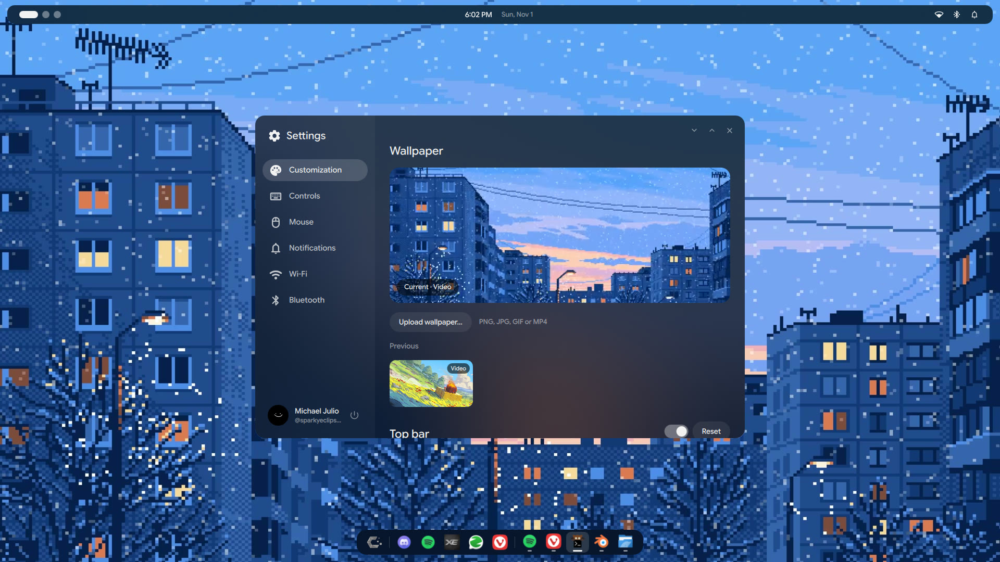 | 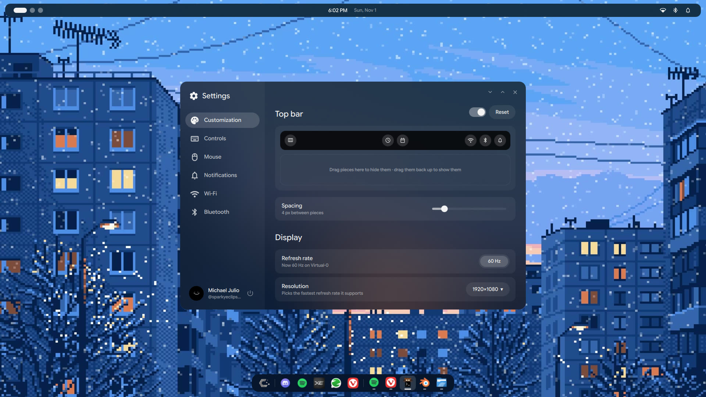 |
| Settings: Customization | Settings: arrange the top bar by dragging |
| 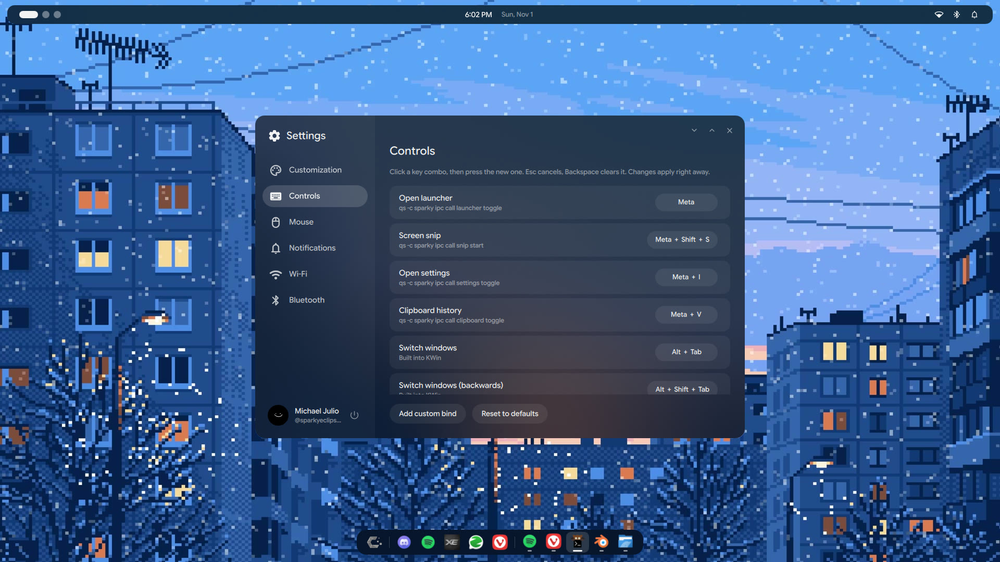 | 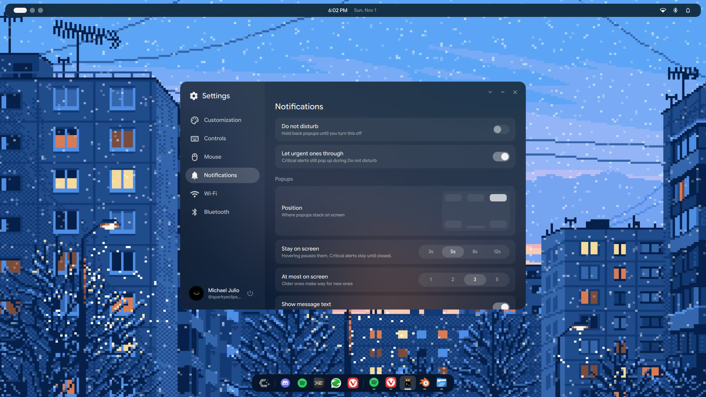 |
| Settings: Controls | Settings: Notifications |
| 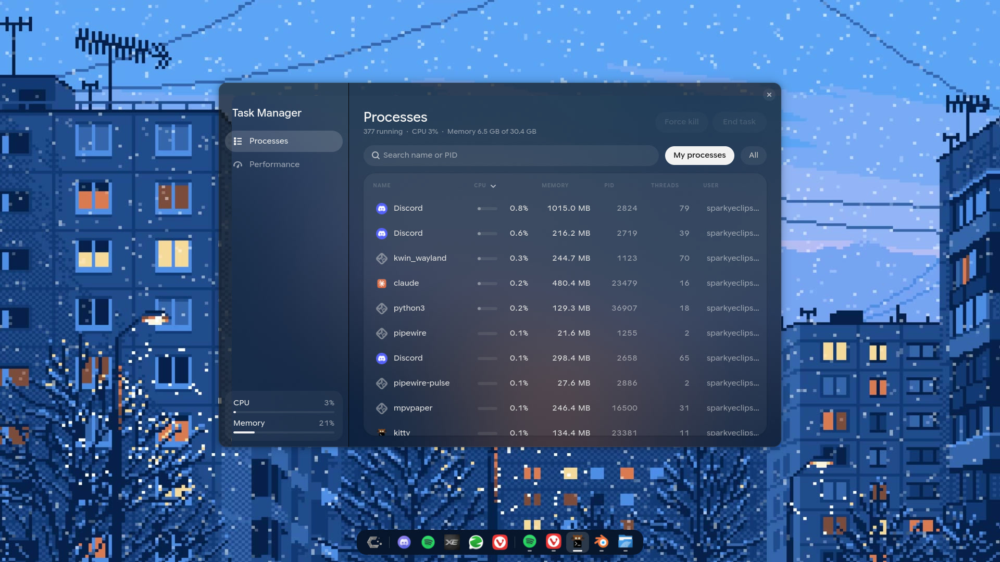 | 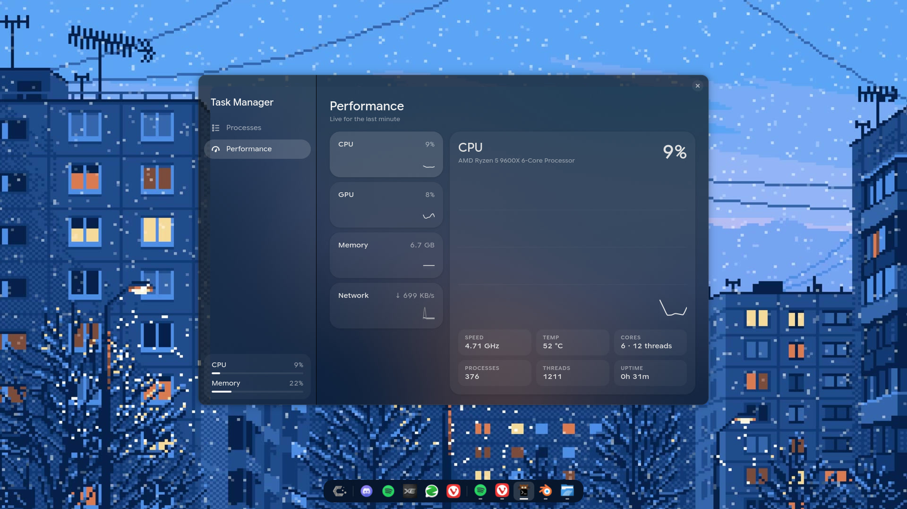 |
| Task Manager | Task Manager: Performance |
| 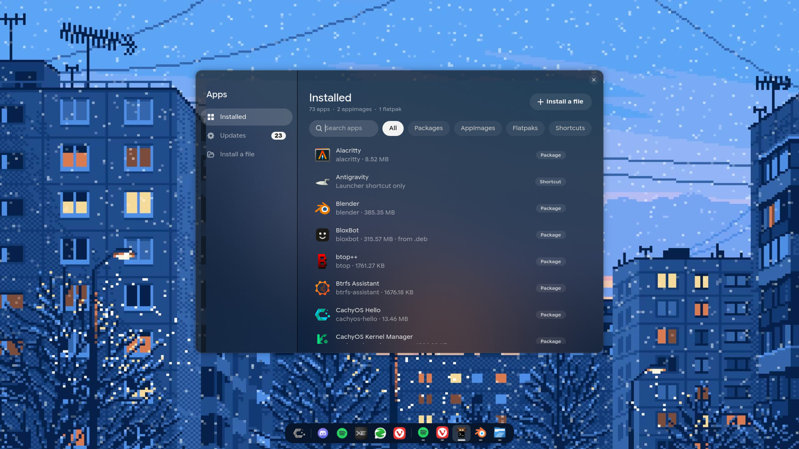 | 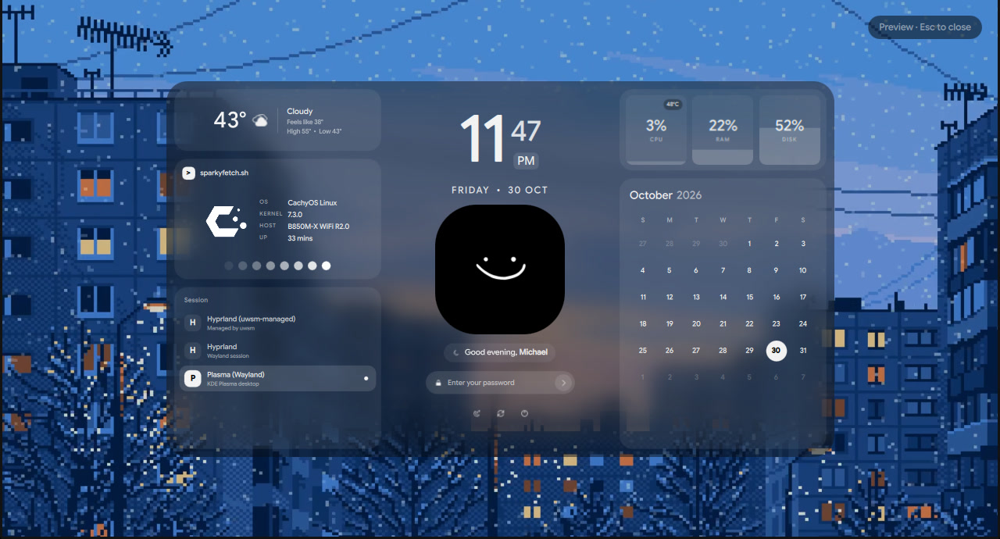 |
| App Manager | Login screen |

## Shortcuts

All of these can be changed in **Settings → Controls**.

| Keys | Does |
|---|---|
| `Meta` | Open the launcher |
| `Meta+I` | Settings |
| `Meta+V` | Clipboard history |
| `Meta+Shift+S` | Screen snip |
| `Meta+Tab` / `Meta+Shift+Tab` | Desktop switcher |
| `Alt+Tab` / `Alt+Shift+Tab` | Window switcher |
| `Ctrl+Alt+Delete` | Power menu |
| `Ctrl+B` | Toggle fullscreen |

Everything is also scriptable over IPC, e.g. `qs -c sparky ipc call launcher toggle`;
`qs -c sparky ipc show` lists every target.

---

## How it fits into KDE

Quickshell can't see KWin's windows or register global shortcuts on its own, so
small helpers do the KDE side and the shell watches what they write:

```
            ┌──────────────── Quickshell (shell/) ────────────────┐
            │ dock · launcher · notifications · settings · ...    │
            └──▲──────────────▲───────────────▲──────────────▲─────┘
   windows.json│   binds.json │  IPC / D-Bus  │              │ IPC
┌──────────────┴──┐ ┌─────────┴──────┐ ┌──────┴────────┐ ┌───┴──────────────┐
│ sparky-windows  │ │ sparky-keys    │ │ sparky-       │ │ sparky-          │
│ KWin script →   │ │ binds.json →   │ │ screencast    │ │ clipboard        │
│ D-Bus → file    │ │ KGlobalAccel   │ │ portal backend│ │ wl-paste history │
└─────────────────┘ └────────────────┘ └───────────────┘ └──────────────────┘
```

* **Windows and desktops** — `kwin/windows/windows.kwinscript.js` runs inside
  KWin and reports windows (with maximize state, desktops, geometry) and virtual
  desktops to `bin/sparky-windows` over D-Bus, which writes
  `$XDG_RUNTIME_DIR/sparky/{windows,desktops}.json`. Activating, closing and
  moving windows go back through the same helper.
* **Shortcuts** — `bin/sparky-keys` registers `~/.config/sparky/binds.json` with
  KGlobalAccel and re-reads it on change, so rebinding in Settings is instant.
* **Blur** — the shell uses the Wayland background-effect protocol; the GTK apps
  use CSS `backdrop-filter`, which GTK 4.24 turns into the same thing. KWin 6.8
  places GTK's region from the visible window edge rather than the surface, so it
  lands offset by the window's shadow; `src/sparky-glass` (a tiny `LD_PRELOAD`
  shim the apps load themselves) moves it back.
* **Screen sharing and "open with"** — `bin/sparky-portal` is an
  xdg-desktop-portal backend (ScreenCast and AppChooser) placed in front of KDE's. It shows the picker, then hands
  KDE the choice as *restore data* (KDE's saved-selection format, encoded by
  `lib/qtstream.py`), so KDE starts the capture without its own dialog. If
  sparky isn't running, requests go to KDE untouched.
* **Polkit** — the shell is the polkit agent while it runs; a small guard
  restarts KDE's agent if the shell exits, so password prompts never go missing.
* **Login screen** — `greeter/` runs in the `cage` kiosk compositor under
  greetd; `bin/sparky-greeter-install` copies it (with the current wallpaper)
  to `/etc/sparky-greeter` and falls back to the previous greeter if it fails.

## Layout

```
shell/            the Quickshell config (qs -c sparky)
  shell.qml         entry point: wires modules together
  theme/Theme.qml   the single source of colours, sizes, fonts, timings
  services/         state and system glue (apps, windows, binds, wallpaper, notifications, ...)
  modules/          bar, launcher, notifications, settings, power, workspaces,
                    screenshare, polkit, clipboard, snip, common widgets
greeter/          the greetd login screen (shares shell/theme)
bin/              helpers, Task Manager (taskman), App Manager (app-manager)
lib/              sparkyui.py (GTK look shared by the two apps), qtstream.py
kwin/             window motion effect, raise script, Alt+Tab theme, window reporter
portal/ dbus/ systemd/   screen-share picker and "open with" registration (bin/sparky-portal)
splash/           sparky.splash: the login-to-desktop splash (bin/sparky-splash-sync feeds it)
lockscreen/       sparky.desktop: the KDE lock-screen package (bin/sparky-lockinfo feeds it data)
cursors/make.py   builds the "Breeze Sparky" cursor theme
src/sparky-glass  blur-placement fix for the GTK apps (LD_PRELOAD shim)
autostart/ apps/  login autostart, launcher entries
screenshots/
```

## Requirements

CachyOS / Arch with KDE Plasma 6.8 on Wayland, and:

`quickshell` (0.3+, built against your Qt), `python` with `dbus-python`, `gobject`
and `psutil`, `gtk4` (4.24+) and `libadwaita`, `wl-clipboard`, `ffmpeg`,
`mpvpaper` (video wallpapers), `zenity`, `qt6-multimedia`, `pipewire`,
`xdg-desktop-portal-kde`, and for the login screen `greetd` + `cage`.
Fonts: Google Sans Flex (UI) and Material Symbols Rounded (bundled in `shell/assets/fonts`).

## Install

```sh
git clone <this repo> ~/sparky-shell
cd ~/sparky-shell
./install.sh            # copies everything into place in your home folder
```

Then log out and back in (or start it now with `qs -c sparky`).
The login screen is installed separately, as it needs root:
`sparky-greeter-install` (and `sparky-greeter-install --revert` to go back).

---

Login-screen layout inspired by [Caelestia](https://github.com/caelestia-dots)'s
lock screen. Icons: [Material Symbols](https://fonts.google.com/icons) (Apache 2.0).
Built on [Quickshell](https://quickshell.org).
